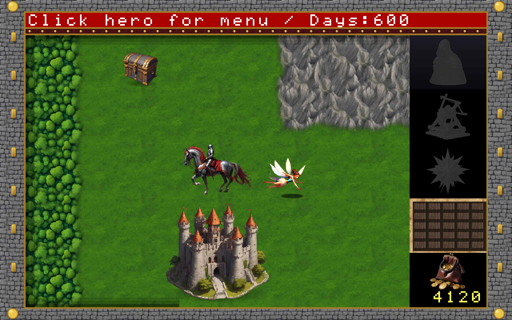

# The Quest for a Stolen Scepter

A turn-based fantasy strategy game: recruit an army, hunt down the realm's
villains under royal contract, and recover the stolen scepter before time runs
out.

[](https://youtu.be/Ozc0ysCaF0c)

*Click the image to watch a 72-second gameplay video on YouTube.*

**Status: stable.** The game is complete and ships with its own content pack
(`packs/stolen-scepter/`): art, maps, text and music made for this game, with
nothing from the original. The game is MIT-licensed (`LICENSE`).

## Installing

Download the latest `Stolen-Scepter-<version>-macos-arm64.dmg` from
[GitHub Releases](https://github.com/damijanc/stolen-scepter/releases/latest),
open it and drag **Stolen Scepter** into Applications. The app is signed with
a Developer ID and notarized by Apple, so it opens without a Gatekeeper
warning. It needs an Apple Silicon Mac running macOS 11 or later.

Saves are kept in your user-data directory and survive updates.

## Playing

- Move with the arrow keys. Diagonals are Home, End, PgUp and PgDn (on a Mac
  laptop, fn plus an arrow), or two arrows pressed together. You can also
  click a revealed tile to walk there.
- `A` army, `V` character, `I` contract, `P` puzzle, `M` world map,
  `O` options reference, `C` controls (sound, music, volume), `U` cast a
  spell, `S` search for the Scepter, `F` fly, `L` land, `W` end the week,
  `D` dismiss a troop.
- ESC closes whatever is open. On the bare overworld it opens the Game Menu
  (Save / Load / Quit). `Q` saves to slot 0 and shows a confirmation, and Ctrl+Q quits.
- Rest is numpad 5 only, as in the original, so it cannot be used on a
  keyboard without a numpad.

## Building from source

Only needed if you want to work on the game. Contributors and agents should
read `AGENTS.md` first.

1. Install a Rust toolchain with [rustup](https://rustup.rs).
2. Clone this repository.
3. Run the game with its own pack:

   ```sh
   cargo run -p openbounty-shell --release -- --pack packs/stolen-scepter
   ```

A local, unsigned DMG can be built with `tools/make_dmg.sh`; signed releases
are cut by pushing a `vX.Y.Z` tag, which runs `.github/workflows/macos-dmg.yml`.

### Flags

| Flag | Meaning |
|---|---|
| `--pack <dir \| file.openbounty \| name>` | The game pack to load. Without it, one discovered pack loads silently and two or more open a picker. |
| `--seed <n>` | Fixed world seed. Without it, the seed comes from time, name and class, so every run is a new world. Use a fixed seed to reproduce a bug. |
| `--save-dir <dir>` | Keep save slots in `<dir>` instead of the user-data directory. Useful for throwaway test saves. |

A reproducible test session:

```sh
cargo run -p openbounty-shell --release -- --seed 1 --save-dir /tmp/kb-play --pack packs/stolen-scepter
```

### Debug menu

F10 opens the debug menu, for setting up scenarios: `G` +50000 gold,
`V` +100 leadership, `M` spell power, `U` +1 of every spell, `S` siege
weapons, `F` flight, `N` next continent, `O` clear the fog, `W` win,
`L` lose screen.

### Verifying behaviour

`specs/play-verification.md` describes the game section by section, with
scenarios to check in play. Results go into
`specs/play-verification-findings.md`.

### Tests

```sh
cargo fmt --all --check
cargo test --workspace
```
